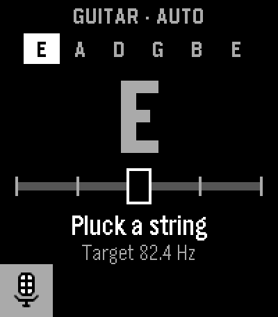
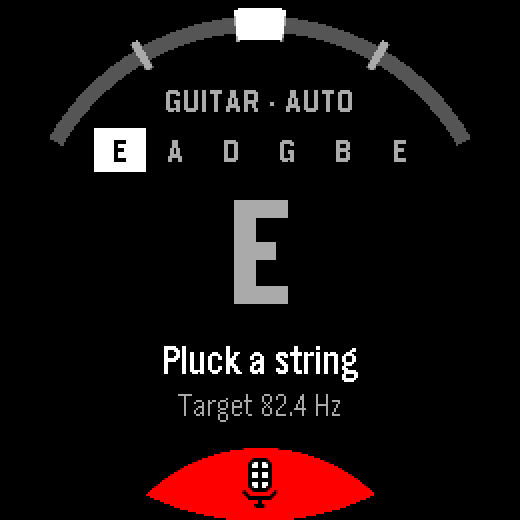
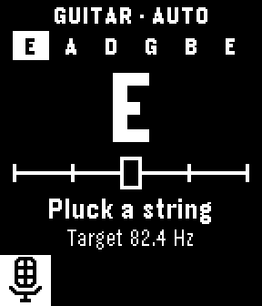

# Guitar Tuner

A tuner for Pebble watches that listens with the watch's own microphone. Pluck a string and the watch shows the note, how far off it is, and buzzes once when it's in tune. Works without the phone.

  

## Features

- **Instruments** — guitar (E A D G B E), 4-string bass (E A D G), ukulele (G C E A)
- **Chromatic mode** — nearest note with octave (e.g. C#4), about 39 Hz to 1.2 kHz, A4 = 440 Hz
- **Auto or manual** — picks the string you're playing, or lock one string yourself
- **Readable at arm's length** — large note, flat/sharp triangles, full-screen fill when in tune
- **Haptic** — one short buzz when the string reaches in tune (±5 cents)
- **On-watch detection** — pitch is worked out on the watch; no audio leaves it

## Supported Platforms

| Platform | Watch | Status |
|----------|-------|--------|
| Emery | Pebble Time 2 | Tested on a real watch |
| Gabbro | Pebble Round 2 | Tested on a real watch with an earlier version |
| Flint | Pebble 2 Duo | Emulator only, not tested on a real watch |

## Requirements

- PebbleOS 4.44.3 or newer (the raw microphone API)
- In the Pebble phone app: Settings → Plugins → enable the plugins / permissions preview, then allow the microphone for Guitar Tuner

## Controls

| Action | Button |
|--------|--------|
| Auto / manual string | SELECT |
| Previous / next string | UP / DOWN |
| Choose instrument | Hold SELECT |

## Building

Requires the Pebble SDK 4.44 or newer.

```
pebble build
pebble install --emulator emery    # emulator
pebble install --phone IP_ADDRESS  # real watch
```

`TUNER_DEBUG=1 pebble build` adds a "Record clip" menu item and pitch trace logging, used to tune the detector on real watch-mic audio.

## How it works

The mic is sampled at 16 kHz. Every 40 ms the last 1024 samples are filtered and run through a YIN-style difference function with parabolic interpolation and an overtone check. Readings pass a median filter and smoothing before they reach the screen. The code is in `src/c/pitch_detector.c` and `src/c/pitch_smoother.c`.

## Credits

- Note font: [Barlow Condensed](https://github.com/jpt/barlow) by Jeremy Tribby, SIL Open Font License (`resources/fonts/Barlow-OFL.txt`)
- App icon: guitar headstock by Joel Crane

## License

MIT, see [LICENSE](LICENSE). The font keeps its own licence.
